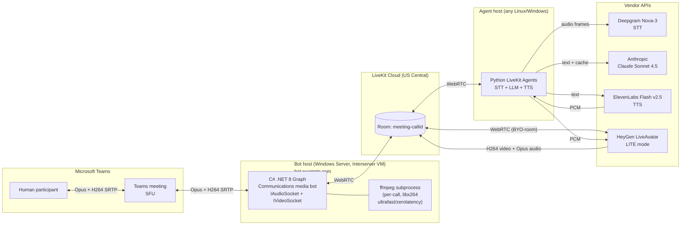

# Architecture

This is the system architecture for the Teams Avatar Agent ("Iris"), v0.3 (post 2026-05-20 end-to-end validation).

## High-level diagram

> Note for editors: the diagram avoids `{...}` literal braces (Mermaid parses them as rhombus-shape declarations) and avoids periods inside dotted-edge labels (`H.264` was previously breaking the dotted-edge syntax). Use `H264` in labels or wrap edge labels in `|"..."|` if you want to retain the dot.

## What runs where

| Component | Host | Language | Why this host |
|---|---|---|---|
| Graph Communications media bot | Windows Server (Interserver) | C# .NET 8 | `Microsoft.Skype.Bots.Media` is native Windows-only |
| Per-call FFmpeg encoder | Same Windows VM, spawned by the bot | — | Re-encode LiveKit I420 → H.264 Annex-B for `IVideoSocket.Send` (see "Internal transcode" below) |
| Python LiveKit Agents | Same Windows VM (for v1) | Python 3.12 | Linux-portable; co-located for latency |
| LiveKit room | LiveKit Cloud | — | Managed SFU |
| HeyGen LiveAvatar | LiveAvatar Cloud | — | Joins our LiveKit room as a publisher |
| Vendor APIs (Anthropic, Deepgram, ElevenLabs) | Their cloud | — | — |

## Invocation paths

Three ways a call ends up at the bot's `/api/calling` webhook:

1. **`/api/join?meetingUrl=...`** — the daily-driver path for dev and scripted dispatch. Bot calls `client.Calls().AddAsync(...)` against the meeting URL, Microsoft sends the resulting call lifecycle notifications back to `/api/calling`. No Teams licensing or UI involvement.
2. **1:1 chat with the bot → video call.** User installs the Teams app, opens Iris's chat, clicks the video icon. Teams routes a peer-to-peer call to `/api/calling`. Limited to 1:1.
3. **Resource Account (Application Instance) in +Add Participants.** Bot's AAD app id is registered as a Teams Application Instance via `New-CsOnlineApplicationInstance`; the resulting "user" appears in the Global Address List. Requires a Teams Phone-family license (free trial available). See article 12 for the full constraint and the licensing prerequisite trap.

Microsoft does not currently offer a UI path to add a calling bot to an existing multiparty meeting outside of #3. The in-meeting `+ Apps` button is for tab/extension apps, not calling participants.

## Why this shape

- **LiveKit is the seam.** The C# bot only knows about a LiveKit room; the Python agent only knows about a LiveKit room; the avatar only knows about a LiveKit room. Either half can be replaced without touching the other. That's how we A/B'd Beyond Presence vs HeyGen LiveAvatar in 30 minutes — one env var.
- **The C# bot is the only Windows-bound piece.** Everything else is portable. We co-locate today for latency; we can split later.
- **Avatar joins our room directly** (no bridging hop). This was the original constraint that ruled in Beyond Presence in v0.1; HeyGen LiveAvatar's new product satisfies the same constraint, so the architecture is unchanged.

## Internal transcode (LiveKit → Teams video)

The PRD asked for pre-encoded H.264 NAL passthrough end-to-end. In practice we re-encode inside the bot because `Livekit.Rtc.Dotnet` 0.1.2 does not expose encoded frames at all — `RemoteVideoTrack` only yields decoded I420. We spawn one `ffmpeg` subprocess per call (libx264 ultrafast, tune zerolatency, baseline profile, AUD enabled), feed it I420 over stdin, parse Annex-B access units off stdout, and ship each AU to `IVideoSocket.Send` wrapped in a `VideoSendBuffer`. Full rationale, the four-way decision (ADR-009), and the three implementation surprises are in `docs/articles/10-livekit-to-teams-video-bridge.md`. Upstream research (option 4 — patch the wrapper) was closed-as-not-viable on 2026-05-20; details in `docs/proposals/upstream-encoded-frame.md`.

## Target latency budget (steady state, turn 2+)

| Stage | Budget | Source |
|---|---|---|
| End-of-turn detection (LiveKit turn-detector v2 + preemptive generation) | 250–400 ms | LiveKit Agents 1.5 |
| STT finalize | 50–150 ms (parallel with EoT) | Deepgram Nova-3 |
| Claude Sonnet 4.5 TTFT (prompt-cached) | 400–600 ms | Anthropic |
| TTS TTFB | 75–200 ms | ElevenLabs Flash v2.5 |
| Avatar first-frame + Teams egress | 200–450 ms | LiveAvatar |
| **Total mouth-closed → first syllable** | **~1.0–1.4 s** | — |

Validated empirically:

- **2026-04-26 (LiveKit playground, no Teams):** cache-warm turns hit ~2.0 s end-to-end without preemptive generation; the post-test commit enabled `preemptive_generation=True` to claw back 400–600 ms.
- **2026-05-20 (real Teams meeting via `/api/join`):** subjective round-trip lag was ~1.0–1.5 s — consistent with the budget plus Teams' own ingress + egress jitter buffers (~40–60 ms each side). No per-stage telemetry yet; the Phase 3 metrics aggregation CLI will turn this into a dashboard.

## Hard constraints carried over from PRD §5.4

1. **Direct public IPv4** on the bot host (no shared VIP / NAT). Interserver VM has this; ILPIP is Azure-specific and not applicable.
2. **VM-pinned calls** — a call belongs to the exact VM that accepted it. No graceful drain, so don't scale in while sessions are active.
3. **~~H.264 must be pre-encoded NAL~~ submitted to `IVideoSocket`.** Still true at the socket boundary, but the encode happens inside the bot process via the per-call FFmpeg subprocess described above. CPU cost on this VM is ~15-20% per call at 640×360@30 — acceptable for v1 single-call usage; a real ceiling for multi-call scaling.
4. **HeyGen LiveAvatar republishes synced A/V.** Agent must run with `RoomOutputOptions(audio_enabled=False)` so we don't double-publish TTS audio.
5. **Prompt caching is mandatory** on the Claude system prompt. Without it, TTFT roughly doubles on turn 2+ (verified in the 2026-04-26 session: 1.89 s cold → ~300–600 ms after cache warm).
6. **`TrackPublishOptions.Source = SourceMicrophone`** on the bot's audio publish. LiveKit Agents' RoomIO filter only subscribes to mic-tagged tracks by default; an untagged track is silently ignored and the STT pipeline never sees the human's audio. Surfaced in the 2026-05-20 e2e debug (article 11 §Layer 4).
7. **`bridge.StartAsync` must be idempotent.** Graph's `call.OnUpdated` fires for every sub-resource change, not just state transitions. Concurrent `StartAsync` invocations race on the `_room` field and brick audio capture. Two `Interlocked.Exchange` latches (one in `CallHandler`, one in `LiveKitBridge`) guard this. Article 11 §Layer 6.

## Non-goals (unchanged from PRD §1)

- No Recall.ai browser-automation path (Microsoft MC1251206 risk).
- No Remotion (offline renderer).
- No Zoom / Google Meet / mobile in v1.
