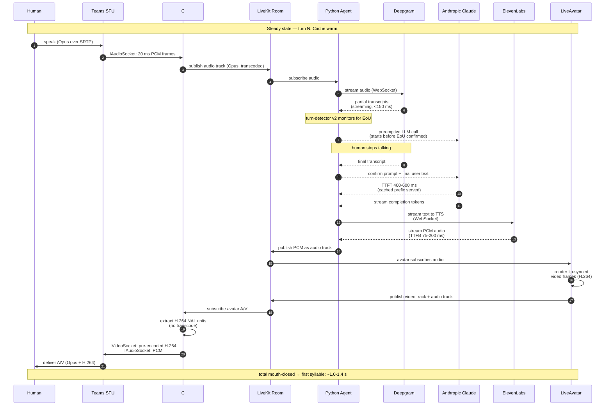

# Dataflow — single conversational turn

Sequence of message flows for one round of "human speaks → Iris responds" in a live Teams meeting. Captures both control plane (Graph signaling) and data plane (audio/video frames).



## What each layer is responsible for

| Layer | Owns | Doesn't own |
|---|---|---|
| C# media bot | Teams ↔ LiveKit bridging, raw frame movement, codec repackaging (no transcode), call signaling | LLM, STT, TTS, avatar rendering, conversational logic |
| LiveKit room | Routing publishers → subscribers, codec negotiation, ICE/SRTP | Anything stateful per-meeting |
| Python agent | Conversational logic, system prompt, turn detection, plugin orchestration, per-turn metrics | Anything below the plugins |
| Deepgram / Anthropic / ElevenLabs / LiveAvatar | Their respective SaaS contracts | Each other |

## Failure handling per stage

| Failure | Detection | Recovery |
|---|---|---|
| Deepgram WebSocket drops | No partials in 3 s | Reconnect transparently; no user-visible message |
| Claude API error / rate limit | HTTP 5xx or 429 | Iris says "Sorry, I lost my train of thought — could you repeat that?" |
| ElevenLabs TTS error | Stream error | Retry once; on second failure, fall back to LiveKit's silero TTS plugin (lower quality but local) |
| LiveAvatar disconnect | Avatar participant leaves room | Agent continues audio-only; static "AI" poster image as fallback video track |
| C# bot process crash | Health-check failure | VM-pinned call drops; supervisor restarts bot. **Do not auto-rejoin in v1.** |

## Per-turn metrics emitted to `./logs/turns/{callId}.jsonl`

The agent writes **one JSONL line per `metrics_collected` event** (not per turn). Per-turn aggregation is computed downstream by joining lines on `speech_id`. Per-event is crash-safe — if the agent dies mid-call, every line up to the crash is intact on disk.

Each line wraps a LiveKit Agents metric object (`STTMetrics`, `LLMMetrics`, `TTSMetrics`, `EOUMetrics`, `VADMetrics`) with an envelope:

```json
{
  "call_id": "3c005780-f05f-4d7e-a97e-79a9c8649d33",
  "ts": "2026-05-16T08:35:12.345Z",
  "type": "llm_metrics",
  "speech_id": "SP_abc123",
  "data": {
    "type": "llm_metrics",
    "label": "anthropic.LLM",
    "request_id": "req_...",
    "timestamp": 1779200112.345,
    "duration": 1.240,
    "ttft": 0.487,
    "cancelled": false,
    "completion_tokens": 38,
    "prompt_tokens": 2156,
    "prompt_cached_tokens": 1432,
    "total_tokens": 2194,
    "tokens_per_second": 30.6,
    "speech_id": "SP_abc123",
    "metadata": {}
  }
}
```

To assemble the per-turn record the PRD §5.5 acceptance work needs (p95 EoU → first-bot-audio-frame), group by `speech_id` and pull:

| Per-turn field      | Source event       | Field on `data`              |
|---|---|---|
| `eot_ms`            | `eou_metrics`      | `end_of_utterance_delay × 1000` |
| `claude_ttft_ms`    | `llm_metrics`      | `ttft × 1000`                |
| `claude_total_ms`   | `llm_metrics`      | `duration × 1000`            |
| `claude_*_tokens`   | `llm_metrics`      | `*_tokens`                   |
| `tts_ttfb_ms`       | `tts_metrics`      | `ttfb × 1000`                |
| `tts_chars`         | `tts_metrics`      | `characters_count`           |
| `stt_final_ms`      | `stt_metrics`      | `duration × 1000` (closest by timestamp) |

`avatar_first_frame_ms` and the bot-side "first-frame-to-Teams" timestamps will be added by a later phase that has the bot write its own `logs/bot-audio.jsonl`. For now the agent-side metrics are within ~5–20 ms of user-perceived latency since the bot's audio pump is straight-through pacing.

Override the log directory via `BOT_TURN_LOG_DIR` env var; default is `./logs/turns/` relative to the repo root.
