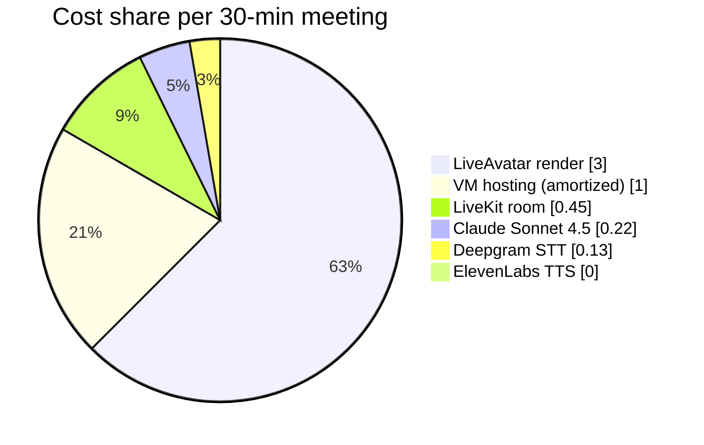

# Vendor costs — per 30-minute meeting

Concrete cost model for one 30-minute Teams meeting with Iris as a participant. Numbers are grounded in real metrics from the 2026-04-26 LiveKit playground A/B session and current vendor public pricing.

## Baseline assumptions

- Meeting length: 30 minutes
- ~50 conversational turns (1.7 turns/min average — derived from playground)
- Conversation cache warms at ~turn 4–6; steady-state cache hit rate **~70%** by minute 5
- Human ↔ Iris talk ratio ~2:1 (humans talk 20 min, Iris ~10 min)
- 1-on-1 meeting (one human + Iris)
- LiveAvatar in **LITE mode** (we provide TTS, 1 credit/min)

## Per-meeting cost breakdown

| Vendor | Unit cost | Usage / 30 min | Cost / meeting |
|---|---|---|---|
| **Anthropic Claude Sonnet 4.5** | $3.00 / MTok input (uncached) $0.30 / MTok input (cached read) $3.75 / MTok input (cache write) $15.00 / MTok output | ~110k input tokens (70% cached) ~3.7k output tokens | **$0.22** |
| **Deepgram Nova-3** | $0.0043 / minute (committed) | 30 min | **$0.13** |
| **ElevenLabs Flash v2.5** | included in Creator plan ($22/mo, currently free for 1 yr via Lenny's Pass) | ~7,800 chars | **$0.00** |
| **HeyGen LiveAvatar (LITE)** | Essential $100/mo for 1,000 credits = $0.10/credit 1 credit/min in LITE mode | 30 credits | **$3.00** |
| **LiveKit Cloud** | ~$0.005 / connection-minute (3 publishers per meeting: bot, agent, avatar) | 90 connection-min | **~$0.45** |
| **VM hosting (Interserver)** | $30–50 / month amortized Capacity ~50 30-min meetings/mo at moderate utilization | 1 meeting | **~$1.00** |
| **Total per 30-min meeting** | | | **~$4.80** |

Per minute: **$0.16/meeting-minute** — well under PRD §10's $0.35–$0.50/min projection (we're at ~30–50% of budget).

## Cost dominance

LiveAvatar alone is **62% of per-meeting cost**. Two implications:

1. If we ever drop LiveAvatar (e.g., for a cheaper Hedra-equivalent that doesn't sunset, or for an open-source local renderer), per-meeting cost falls below $2 fast.
2. Claude is **only 5% of per-meeting cost** thanks to prompt caching. Without caching it would roughly double; even then it would be a minor line item.

## Monthly cost scenarios

| Volume | Per-meeting | Monthly subtotal | Notable plan switch |
|---|---|---|---|
| 5 meetings/month (light dev) | $4.80 | $24 | LiveAvatar Starter $19/150 cr is enough |
| 20 meetings/month (active dev) | $4.80 | $96 | Need LiveAvatar Essential ($100/mo for 1k cr); ElevenLabs Creator stays within plan |
| 50 meetings/month (light prod) | $4.80 | $240 | LiveAvatar Essential covers; ElevenLabs may overage |
| 100 meetings/month (heavier prod) | $4.80 | $480 | LiveAvatar Pro tier; ElevenLabs upgrade |

PRD §10 done-criteria: total cost per meeting-minute logged within 2× of $0.35–0.50/min. **At current vendors we're at ~$0.16/min — well within budget.**

## Cost-saving levers, ranked by impact

1. **Avatar render (LiveAvatar)** — 62% of per-meeting cost. Watch the avatar vendor market for cheaper real-time options. Hedra was the strongest candidate at $0.05/min flat but sunset their real-time product on 2026-04-15. Track Tavus, Simli, and any new entrants.
2. **VM hosting** — fixed cost, amortizes well at scale. Phase 2.5+ if we move to a cloud-native deploy (Azure container apps, etc.) we might shed the VM cost in favor of per-meeting compute.
3. **LiveKit usage** — already very cheap. The free tier covers light dev. Move to paid only if we hit production volume.
4. **Claude caching** — already enabled. Worth verifying cache hit rate stays >50% in production.
5. **Deepgram volume discount** — kicks in above $1k/mo committed spend. Not relevant until production scale.

## What's *not* in this model (yet)

- **Custom avatar training cost** — LiveAvatar custom avatar slot included in Essential and above; one-time time investment per persona, no marginal cost.
- **Storage / logging infrastructure** — local files for v1 (free); Supabase Pro is in our Lenny's Pass year-free if we want Postgres-backed audit logs.
- **Outbound bandwidth from Interserver** — typically included in the VM plan; verify on the actual invoice.
- **Compliance/legal review fees** — required before any external-customer demo per PRD §6.1; budget separately.
